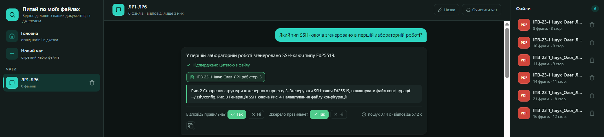
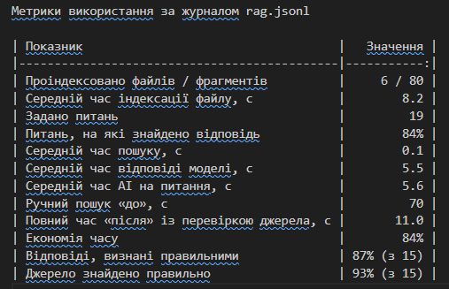

# Модульна контрольна робота №1

**Тема:** «Як я покращив своє життя за допомогою AI»: пошук відповідей у власних документах (RAG на локальних моделях)
**Виконав:** Іщук Олег Сергійович, ІПЗ-23-1
**Репозиторій:** `mkr1/` (код у `solution/`, докази в `evidence/`, відео `demo.mp4`)

## 0. Планування

| Поле | Значення |
|---|---|
| Проблема | Під час навчання я регулярно шукаю відповіді у власних матеріалах: лекціях, конспектах, презентаціях, підручниках у різних форматах (pdf, docx, pptx). Пошук по словах (Ctrl+F) не працює, якщо я не пам'ятаю точного формулювання, а перегортати десятки сторінок довго |
| Поточний процес | Вручну: згадати, у якому файлі це могло бути → відкрити → Ctrl+F за ключовими словами або гортання → прочитати → за потреби повторити в іншому файлі. 4 кроки, ≈1,2 хв (70 с) на питання. Засічено на 5 реальних питаннях, на ще одне відповідь вручну знайти не вдалося |
| Дані | 6 файлів pdf: мої звіти до лабораторних робіт з Linux (ЛР1–ЛР6), 67 сторінок разом. Застосунок також читає docx, pptx, txt, md |
| Рівень рішення | **2: RAG / Tools.** Потрібні дані, яких немає в моделі (мої файли), і їх забагато, щоб помістити в один запит. Пошук по смислу + відповідь лише за знайденими фрагментами |
| Метрика успіху + ціль | (1) Час від питання до перевіреної відповіді: ціль ≤ ⅓ від ручного. (2) Відповіді, які я визнав правильними (кнопки «Так/Ні» під відповіддю): ≥ 75%. (3) Джерело вказано правильно: ≥ 85%. (4) Чесна відмова («не знайдено») на питаннях, відповіді на які у файлах немає: усі або майже всі (перевіряю вручну на кількох питаннях) |
| Ризики / fallback | Модель вигадує відповідь попри RAG → завжди показується джерело, є відмова за низької схожості та перевірка на питаннях без відповіді; пошук знаходить не той фрагмент → фрагменти видно користувачу, можна звузити пошук до потрібних файлів; Ollama недоступна → повідомлення в інтерфейсі |

## 1. Проблема

Під час навчання я регулярно шукаю відповіді у власних матеріалах: звітах до лабораторних, лекціях, презентаціях. Це повторюється перед кожним захистом, забирає час і не вдається, якщо не пам'ятаєш точного формулювання. Деталі в таблиці розділу 0.

## 2. КПІ та ситуація «до»

**Метрики й цілі:** (1) час від питання до перевіреної відповіді ≤ ⅓ від ручного; (2) відповіді, визнані правильними, ≥ 75%; (3) правильне джерело ≥ 85%; (4) чесна відмова на питаннях без відповіді у файлах: усі або майже всі.

**Виміряно «до»:** вручну ≈70 с на питання (4 кроки: згадати файл, відкрити, шукати, прочитати).

Для «до» я шукав відповіді вручну на 6 питань по ЛР1–ЛР6, знаючи заздалегідь, у якому файлі шукати, тобто ручний час занижений на користь ручного методу. На одне з шести питань (PID служби в ЛР4) відповідь вручну знайти не вдалося, воно в середнє не входить. Ці ж шість питань я потім поставив застосунку.

## 3. Рівень AI-рішення

| Питання з завдання | Відповідь для цієї задачі |
|---|---|
| Чи вистачає одного запиту/промпту? | Ні: усі мої матеріали (десятки сторінок) не вміщуються в контекст 7B-моделі (4096 токенів), та й вставляти їх щоразу незручно |
| Чи потрібні дані, яких немає в моделі? | **Так**: мої особисті лекції та конспекти. Це і є ознака рівня 2 (RAG) |
| Чи потрібні кроки, що залежать від попередніх? | Ні: порядок фіксований (знайти фрагменти → відповісти) і заданий кодом. Модель сама не обирає наступну дію, тому агент не потрібен |
| Чи є сотні власних прикладів, на яких prompt/RAG програють? | Ні, тож fine-tuning не потрібен |
| Чи це задача для власної ML-моделі? | Ні |

**Альтернативи, які розглядались:**

| Альтернатива | Чому не обрана |
|---|---|
| Ctrl+F / пошук по файлах | Шукає лише збіг слів, не розуміє питання своїми словами; саме цей спосіб є базою «до» |
| Рівень 1: вставляти текст у чат | Матеріали не вміщуються в контекст; кожного разу треба знаходити й вставляти потрібне вручну |
| Хмарні сервіси (ChatGPT з файлами, NotebookLM) | Матеріали передаються стороннім, потрібні акаунт і підписка, немає контролю над тим, як шукається і як вимірюється якість. Локальна модель безкоштовна й працює офлайн |
| Векторна база (Chroma, FAISS) | Для обсягу одного студента зайва складність; перебір на numpy достатній |
| Агент із декількома кроками пошуку | Базове питання розв'язується одним пошуком; агент додав би складності й нестабільності |

## 4. Реалізація

Веб-застосунок на Flask. Користувач завантажує кілька файлів різних форматів, кожен чат має власний набір файлів, і питання ставляться природною мовою лише по файлах відкритого чату.

1. **Індексація.** Файл читається (кожна сторінка чи слайд окремо), ріжеться на фрагменти по ≈900 символів із перекриттям, для кожного фрагмента модель `bge-m3` рахує вектор. Індекс зберігається на диску.
2. **Пошук.** Питання перетворюється на вектор, і за косинусною схожістю знаходяться 4 найближчі фрагменти. Порядок трохи коригується збігом слів питання з текстом фрагмента (допомагає з термінами й назвами). Пошук іде тільки по файлах відкритого чату.
3. **Відповідь.** Модель `qwen2.5:7b-instruct` отримує лише ці фрагменти й відповідає виключно за ними. Спершу вона наводить дослівну цитату, потім коротку відповідь на її основі. Застосунок перевіряє, що цитата справді є у фрагменті, і показує «Підтверджено цитатою». Текст відповіді з'являється поступово (стрімінг), результат у JSON: чи знайдено відповідь, цитата, текст, номери використаних фрагментів. Якщо відповіді немає, застосунок каже про це замість вигадування.
4. **Перевірка користувачем.** У відповіді видно файл, сторінку та текст фрагмента. Користувач відмічає, чи відповідь і джерело правильні. Це йде в журнал і в метрики.


*Рис. 1. Відповідь за документами з розгорнутими джерелами*

### Архітектура

```
Файли (pdf, docx, pptx, txt, md)
   │ ingest.py: текст по сторінках/слайдах
   ▼
Нарізка на фрагменти (rag.chunk_pages, ≈900 символів, перекриття 150)
   │ Ollama /api/embed, модель bge-m3 (на CPU)
   ▼
Індекс: фрагменти + вектори (numpy, зберігається у data/)
   ▲
   │ топ-4 за косинусною схожістю
Питання ──► вектор питання
   │
   ▼  якщо схожість найкращого фрагмента < MIN_SCORE: відмова без виклику моделі
Ollama /api/chat, модель qwen2.5:7b-instruct (prompt + JSON-схема)
   │ {found, quote, answer, sources}; перевірка, що quote є у фрагменті
   ▼
Відповідь + фрагменти-джерела ─► користувач ─► оцінка ─► evidence/logs/rag.jsonl
                                                              │
                                                   stats.py ─► метрики
```

Векторної бази немає навмисно: для тисяч фрагментів повний перебір на `numpy` займає мілісекунди, а залежностей менше.

### Використані технології

| Компонент | Що використано |
|---|---|
| Модель відповідей | Ollama, `qwen2.5:7b-instruct` (локально, GPU RTX 4050 6 ГБ) |
| Модель пошуку (embeddings) | Ollama, `bge-m3` (багатомовна, добре працює з українською; запускається на CPU, щоб не відбирати відеопам'ять) |
| Структурована відповідь | JSON-схема в параметрі `format` Ollama |
| Читання файлів | pypdf, python-docx, python-pptx |
| Індекс і пошук | numpy |
| Бекенд / фронтенд | Python, Flask; HTML, CSS, JavaScript без бібліотек |
| Оцінка якості | Оцінки «Так/Ні» під відповідями, `stats.py` за журналом, ручна перевірка інтерфейсу в браузері |

## 5. Ризики та обмеження

| Ризик | Ймовірність / критичність | Що робити |
|---|---|---|
| Модель вигадує відповідь, якої немає у фрагментах | Середня / висока | Prompt вимагає відповідати лише за фрагментами; модель має навести цитату, яку застосунок звіряє з файлом; відмова за низької схожості; фрагменти-джерела показуються для перевірки; вигадування перевіряю вручну на питаннях без відповіді |
| Пошук знаходить не той фрагмент (синоніми, абревіатури, формулювання) | Середня / висока | `bge-m3` для смислового пошуку; користувач бачить джерело й може розгорнути цитату; можна звузити пошук до одного файлу; правильність джерела відмічається кнопкою «Так/Ні» |
| Відповідь розрізана межею фрагмента | Середня / середня | Перекриття між фрагментами 150 символів; розмір фрагмента 900 символів налаштовується |
| Скан без тексту, формули, таблиці-картинки | Середня / середня | Файли без тексту відхиляються з повідомленням; таблиці docx/pptx читаються як текст; OCR поза межами роботи |
| Слабка українська у 7B-моделі | Середня / низька | Терміни лишаються мовою оригіналу; перевірка джерела; можна замінити модель через `OLLAMA_MODEL` |
| Prompt injection у тексті документа чи питання | Низька / середня | Фрагменти й питання передаються як дані, системний prompt забороняє виконувати з них команди |
| Embeddings на CPU довго рахуються для великих файлів | Середня / низька | Індекс зберігається, повторне завантаження незміненого файлу пропускається; можна `EMBED_ON_CPU=0` |
| Ollama недоступна або немає моделі | Середня / низька | Індикатор унизу лівої панелі та повідомлення з командою `ollama pull` |
| Файл змінився, а індекс старий | Низька / середня | Індекс за хешем вмісту: змінений файл з тим самим іменем замінює старий |
| Приватність матеріалів | Низька | Усе виконується локально |

## 6. Реальне використання та докази

Живе використання 26.11.2026: 19 записів у журналі по 6 документах (80 фрагментів, 67 сторінок). З них 15 відповідей я оцінив кнопками «Так/Ні», 3 питання були без відповіді у файлах (перевірка відмов), 1 запис пробний без оцінки. Сирі дані: `evidence/logs/rag.jsonl`, підсумок: `evidence/stats_output.md`.

- `evidence/logs/rag.jsonl`: журнал індексування, питань, відповідей і оцінок
- `evidence/stats_output.md`: підсумок за журналом (`python stats.py`)
- `evidence/screenshots/`:
  - `01_upload.png`: чат із 6 завантаженими файлами
  - `02_answer.png`: відповідь із розгорнутою цитатою
  - `03_answer_lab4.png`: відповідь, яку вручну знайти не вдалося
  - `04_warning.png`: попередження перевірки цитати (відповідь правильна)
  - `05_refusal.png`: відмови на питаннях без відповіді
  - `06_error.png`: помилкова відповідь про `strace -c`
  - `06_stats.png`: метрики `stats.py`

## 7. Результат «після»

| Показник | До AI (вручну) | Після AI |
|---|---|---|
| Час на одне питання | 70 с ≈ 1,2 хв (Ctrl+F, гортання; засічено на 5 питаннях) | 11 с з перевіркою джерела (з журналу, на 15 оцінених питаннях); сам AI ≈5,6 с |
| Економія часу | — | 84% |
| Ручні операції на питання | 4 (згадати файл, відкрити, шукати, прочитати) | 2 (написати питання, переглянути джерело) |
| Відповіді, визнані правильними | — | 87% (13 з 15 оцінених) |
| Джерело вказано правильно | — | 93% (14 з 15 оцінених) |
| Чесна відмова на питаннях без відповіді | — | 3 з 3 (питав вручну) |
| Вартість одного прогону | 0 | 0 (локальні моделі; ≈5,6 с роботи GPU/CPU на питання) |


*Рис. 2. Метрики за журналом використання (`python stats.py`)*

Порівняння з цілями розділу 0. Час: 11 с проти 70 с, це близько 16% від ручного, ціль ≤ ⅓ виконана. Чесна відмова: 3 з 3, ціль виконана. Правильні відповіді: 87% проти цілі 75%, ціль виконана. Правильне джерело: 93% проти цілі 85%, ціль виконана. Мала вибірка (15 питань) дозволяє говорити лише про порядок величини.

## 8. Відповіді на питання

1. **Яку проблему ви вирішували?** Повільний пошук відповідей у власних матеріалах (лекції, презентації, підручники в різних форматах).
2. **Чому вона реальна та корисна для автоматизації?** Перед захистом лабораторних треба швидко знайти у власних звітах конкретні значення: PID, права доступу, час виконання, використані опції. Звітів шість (67 сторінок), і пам'ятати, у якому саме файлі й на якій сторінці це було, неможливо. Пошук по словах не знаходить відповіді, якщо не пам'ятати формулювання.
3. **Як задача виконувалась до AI?** Відкривав файли по черзі, шукав через Ctrl+F або гортав. ≈1,2 хв (70 с) на питання, одну відповідь знайти не вдалося.
4. **Яке AI-рішення ви побудували?** Локальний RAG-помічник: індексує документи різних форматів і відповідає на питання лише за ними, з посиланням на файл і сторінку, а за відсутності відповіді чесно відмовляє.
5. **Чому обрали саме цей рівень?** Потрібні мої приватні дані, яких немає в моделі, і їх забагато для одного запиту, тому рівень 2. Агент і fine-tuning не потрібні (розділ 3).
6. **Які альтернативи розглядали?** Ctrl+F, вставка тексту в чат, хмарні сервіси, векторна база, агент.
7. **Які моделі та інструменти використали?** Ollama з `qwen2.5:7b-instruct` і `bge-m3`, Flask, numpy, pypdf, python-docx, python-pptx. Порівняння з іншими моделями не проводилось.
8. **Які проблеми або помилки виникли?** Під час розробки відповіді спершу були не по темі й надто довгі. Виправлено: промпт вимагає відповідати лише на поставлене питання, модель спершу наводить цитату з файлу, пошук враховує збіг слів питання з текстом, температура 0. Під час вимірювання: (а) на питання про `strace -c` застосунок дав 42 виклики замість 38. Число 42 належить способу C (mmap) у бенчмарку ЛР6, а питання було про `ring_app` з ЛР5, тобто знайшовся схожий фрагмент з іншого файлу (`evidence/screenshots/06_error.png`); (б) на питання про прапорці `lsblk` відповідь неповна: застосунок назвав `-r` і `-b`, а в PDF для плаского списку без заголовка є ще `-n`; (в) на питання про Valgrind відповідь правильна, але перевірка цитати видала попередження, бо в тексті цього PDF слова склеєні без пробілів (`evidence/screenshots/04_warning.png`). Також спершу я помилково оцінив як неправильні відповіді про `noexec`, `Restart=always` і `heap-buffer-overflow`; після звірки з PDF я виправив оцінки на «Так».
9. **Наскільки надійним є рішення?** За моїми оцінками після звірки з PDF правильні 87% відповідей (13 з 15) і 93% джерел (14 з 15). На 3 питаннях без відповіді у файлах застосунок 3 рази відмовив і нічого не вигадав. Відповідь завжди потрібно звіряти з показаним джерелом.
10. **Що змінилося після впровадження?** Пошук відповіді скоротився з ≈70 с до ≈11 с з перевіркою джерела. Платою є 2 відповіді з 15, які я не визнав правильними (одна помилкова, одна неповна), тому джерело завжди перевіряю.
11. **Скільки часу або ресурсів заощаджено?** ≈59 с на питання (≈1 хв), 84% за 15 оцінених питань. Гроші: 0, моделі локальні.
12. **Що змінили б, продовжуючи розвиток?** З реальних помилок випливає: (1) звіряти цитату з файлом без урахування пробілів, бо PDF склеює слова; (2) переранжування знайдених фрагментів, щоб не брати схожий фрагмент з іншого файлу; (3) OCR для сканів.

## Результат роботи

1. **Працююче рішення:** папка `solution/`. Інструкція запуску: `solution/README.md` (залежності, команди, налаштування).
2. **Демонстрація:** `demo.mp4` у корені роботи.
3. **Звіт:** цей файл, `report.md`.
4. **Докази реального використання:** папка `evidence/` (журнал `rag.jsonl`, `stats_output.md`, скріншоти), перелік у розділі 6.
